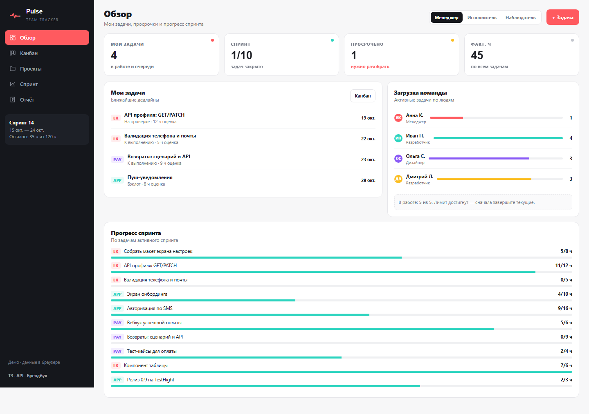

> [← Портфолио Марины Петрушиной](https://mary-rnd.github.io/portfolio/) — сайты, ИИ-боты, трекеры и автоматизация для малого бизнеса и MedTech.

<div align="center">


# Pulse — командный трекер задач

**Kanban, спринты и отчёты в одном рабочем пространстве:** проекты, роли, WIP-лимит и burndown вместо таблиц и переписок.

[](https://mary-rnd.github.io/pulse/)
[](#-что-потрогать-в-живом-демо)
[](#-роли-и-доступ)
[](info/api.md)

**▶ [Открыть живое демо →](https://mary-rnd.github.io/pulse/)** · [ТЗ](info/tz.md) · [Контракт API](info/api.md) · [Брендбук](info/brandbook.md)

</div>

---

## 📌 Заказ

| | |
|---|---|
| **Площадка** | [FL.ru · проект №4523171](https://www.fl.ru/projects/4523171/razrabotka-trekera-zadach.html) |
| **Задача клиента** | Трекер задач по детальному ТЗ и дизайну в Figma: проекты, спринты, роли, оценка и факт трудозатрат, отчёты. Стек заказчика — PHP и React. |
| **Бюджет заказа** | **300 000 ₽** (в заказе указан диапазон от 300 000 до 999 999 ₽) |
| **Тип трекера** | Командный трекер задач (проекты, спринты, роли) |
| **Статус** | MVP готов, живёт в Live; контракт API для этапа 2 описан |

> На заказчиков не откликались: ТЗ использовано как материал для практики и для портфолио.

---

## 😤 Боль клиента

Проект живёт в трёх местах: статусы в таблице, обсуждения в мессенджере, часы вручную в конце месяца. Никто не знает, сколько на самом деле в работе сейчас и что просрочено.

## ✅ Что даёт Pulse

- **Канбан** с фильтрами по проекту, исполнителю и приоритету — и **WIP-лимитом 5**, который реально блокирует перетаскивание шестой задачи.
- **Спринты** с ёмкостью команды и графиком **burndown** по остатку часов.
- **Отчёты**: загрузка по людям, план/факт часов, просроченные задачи.
- **Роли**: исполнитель не трогает чужие задачи, наблюдатель только читает.
- **Экспорт** CSV/JSON, поиск, сохранение после перезагрузки.

---

## 🖼 Скриншоты: первый запуск → финальная версия

<table>
  <thead><tr><th>Первый запуск</th><th>Финальная версия</th></tr></thead>
  <tbody>
    <tr>
      <td></td>
      <td></td>
    </tr>
  </tbody>
</table>

---

## 🔑 Возможности MVP

- **Проекты:** название, код, цвет, участники, дедлайн, прогресс.
- **Задачи:** заголовок, описание, проект, исполнитель, статус, приоритет, оценка и факт часов, дедлайн, теги, чек-лист.
- **Статусы** `backlog → todo → progress → review → done` с WIP-лимитом на «В работе».
- **Спринт:** активный спринт, ёмкость, burndown-график по дням.
- **Учёт времени:** запись часов с комментарием и историей.
- **Отчёты:** загрузка исполнителей, план/факт, просрочки.
- **Поиск, фильтры, массовые действия в списке**, экспорт CSV/JSON.
- **Данные переживают перезагрузку** страницы.

## 👥 Роли и доступ

| Роль | Что может | Что не может |
|---|---|---|
| **Владелец пространства** | проекты, участники, права, удаление | — |
| **Менеджер проекта** | задачи, спринты, назначение, отчёты | не выдаёт права участников |
| **Исполнитель** | свои задачи, статусы, комментарии, часы | не удаляет и не правит чужие задачи |
| **Наблюдатель** | только чтение и отчёты | не меняет данные ни в одном экране |

Права живут в `canEdit()` / `canSee()` — интерфейс строится от них, а не наоборот.

## 🎬 Что потрогать в живом демо

1. Откройте **Канбан** и перетаскивайте задачи в «В работе» до значения **5/5** — шестая не пройдёт.
2. Переключитесь на роль **Наблюдатель** — кнопки создания и редактирования исчезнут во всех экранах.
3. Откройте **Спринт** — burndown перестроится по остатку часов.
4. Добавьте часы в задаче и посмотрите **Отчёты** — план/факт пересчитается.
5. Обновите страницу — задачи, проекты и записи времени на месте.

---

## 🛠 Технологии

| Область | Решение |
|---|---|
| Стек | HTML5 · CSS3 · JavaScript (ES6), без фреймворков и сборки |
| Хранение | `localStorage` + предзаполненные проекты и «команда» |
| Этап 2 | PHP + React: контракт API в [info/api.md](info/api.md) (`409 WIP_LIMIT`, `422` бизнес-правило) |
| Дизайн | графит `#15171C` + коралл `#FF5A5F`, крупные KPI-цифры, пульт, а не документ |
| Адаптив | от 360 px до десктопа, консоль без ошибок |
| Экспорт | CSV / JSON |

---

## 💰 Услуга

| | |
|---|---|
| **Цена проекта** | **120 000 ₽** за клиентский MVP и контракт API · **300 000–400 000 ₽** за полную версию на PHP + React с сервером, авторизацией и правами. Бюджет заказа 300 000 ₽ — верхняя граница для полного продукта, поэтому MVP продаётся как первый этап. |
| **Формат передачи** | Папка проекта, ТЗ, контракт API, инструкция по деплою, список того, что уже готово к переносу на сервер. Дальше — оценка этапа 2 с разбивкой по эндпоинтам. |
| **Допродажи** | серверная часть, авторизация и права, уведомления, импорт из Jira и CSV, зависимости задач, дашборд руководителя, интеграция с Git |

**Порядок работы:** вопросы клиенту → ТЗ и критерии готовности → MVP → тестирование по ролям → 2–3 доработки → публикация и упаковка.

## 📄 Документы

- [ТЗ](info/tz.md) — цель, роли, экраны, функции MVP, критерии готовности, вопросы клиенту
- [Контракт API](info/api.md) — эндпоинты, правила статусов, коды ошибок
- [Брендбук](info/brandbook.md) — палитра, типографика, форма, тон
- [Логотип](info/logo.svg)

## ▶ Запуск локально

```bash
git clone https://github.com/Mary-RND/pulse.git
cd pulse
python -m http.server 8099
# → http://localhost:8099/
```

## ⚠️ Дисклеймер
Учебный проект (кейс 4 FGIp07). На заказ не откликались, данные демонстрационные и хранятся в `localStorage` браузера.
